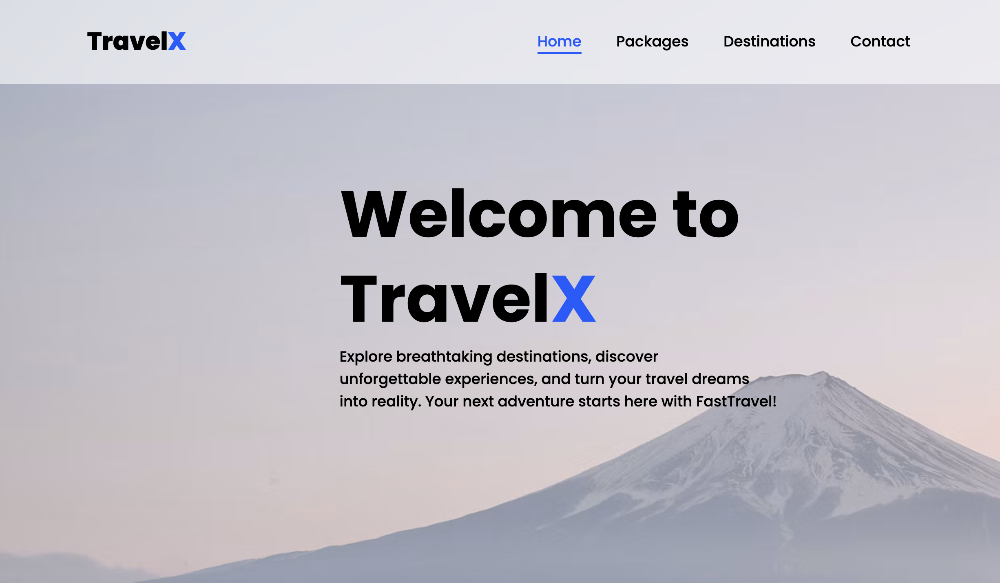
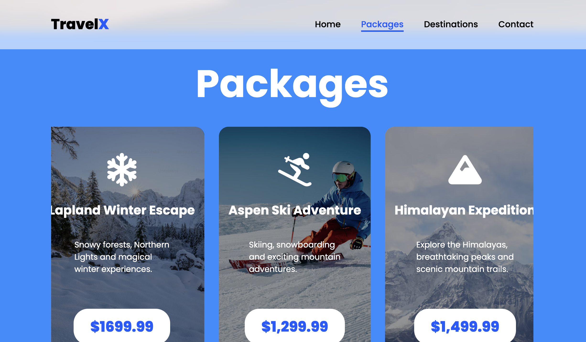
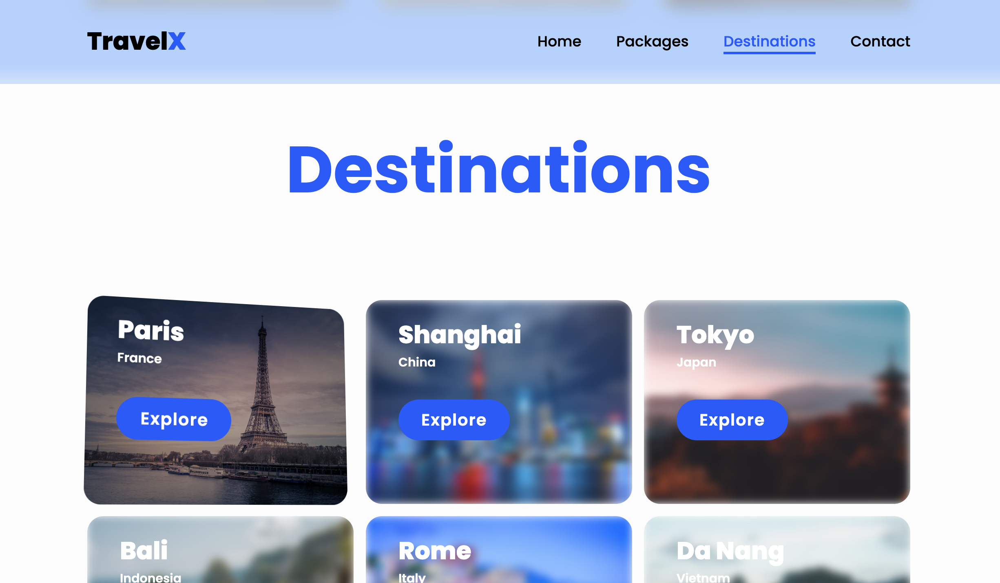
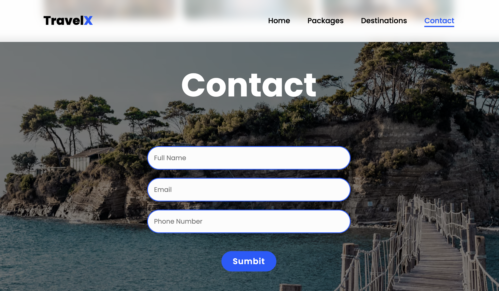
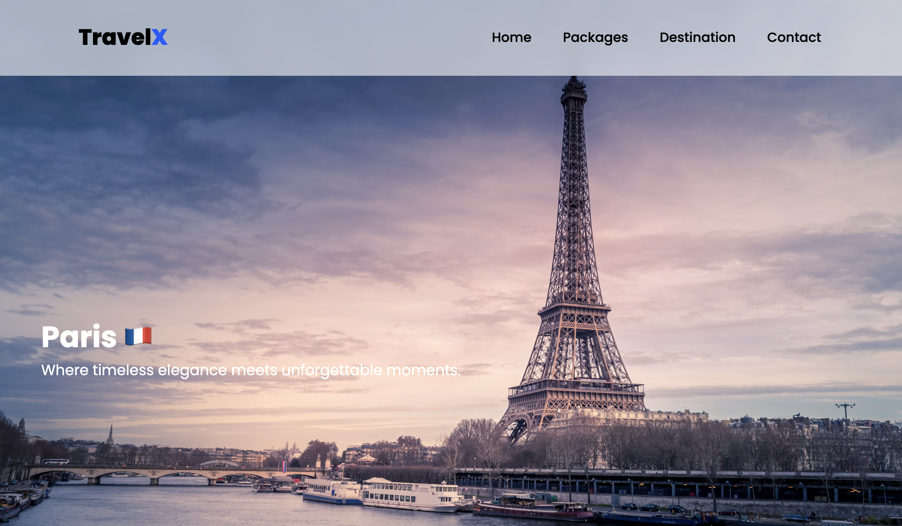
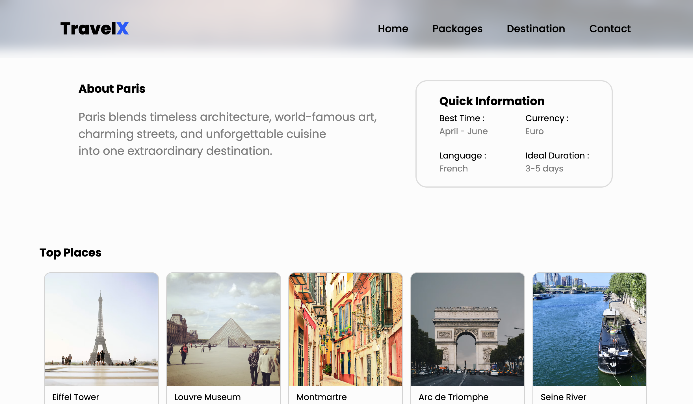
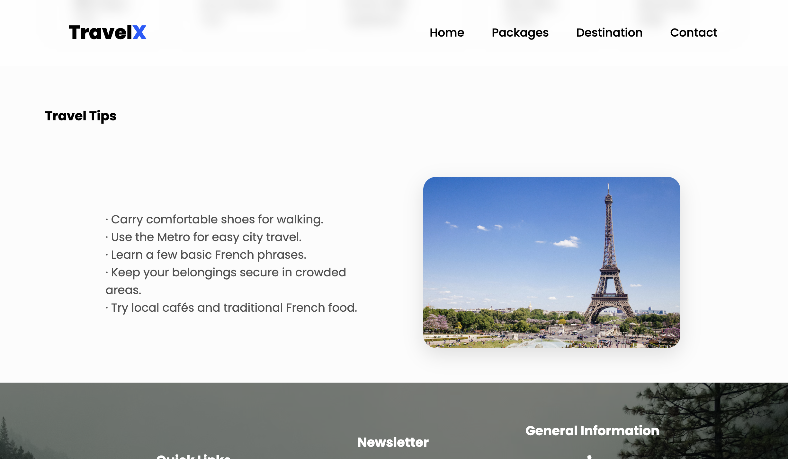

# Travel X 🌍

TravelX is a basically a travel website which is more like a website to explore beautiful destinations around the world.It brings together different places,the different experiences of that place , an overview of Quick Informations and Top places of that destination. Also look out for the travel Tips at the end of each destination page.

## Features

- Explore diff destinations from different parts of the world.
- Browse destinations through the respective pages.
- A special tilt effect on the destination cards.

## Built With

- HTML
- CSS
- JavaScript

## Preview

### Home

### Packages

### Destinations

### Contact

## Example of different Destination Page
## Paris

## NOTE

The Contact form is not connected to my mail as it is a public repository.It is just used as a placeholder
and also the Newsletter section is just a place holder.It will not do anything.Maybe in the futre I might add something.

## Author

Created by **Akhil Siva**

---

Thanks for checking out Travel X!
